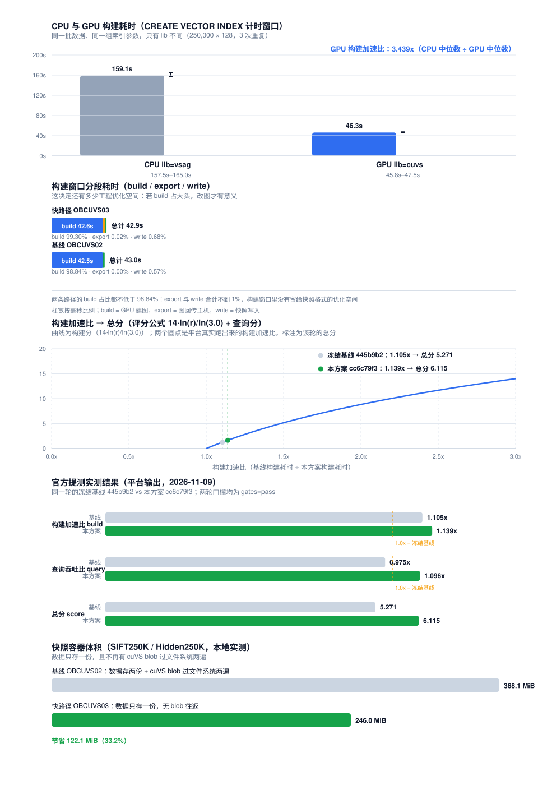

# CPU / GPU 向量索引构建性能对比（中文版）

> 英文版：[`build-performance.md`](build-performance.md)　设计细节：[`fast-snapshot.md`](fast-snapshot.md)
> 对应代码：分支 `amd-cagra-submit`，commit `070be92c`

## 0. 一句话结论

本次改动**不碰建图、不碰搜索参数、不碰数据**，只把 GPU 索引快照里**重复存储的数据集和两次过文件系统的 cuVS blob**去掉，因此**召回在数学上不可能变化**；但它能带来多少加速比，**必须等云端实测**，本文档中所有未实测的数字都明确标注了来源。

---

## 1. 口径：我们比的到底是什么

赛事打分里的"构建耗时"是这条 DDL 的墙钟时间：

```sql
CREATE VECTOR INDEX idx ON tbl(v)
  WITH (distance=l2, type=hnsw, lib=<cuvs|vsag>, m=16, ef_construction=200, ef_search=64);
```

注意表里**已经有数据**。所以这个窗口里至少混着四段：

| 段 | 谁在做 | 改它伤不伤召回 |
| --- | --- | --- |
| ① 向量摄取 + H2D 拷贝 | adaptor（`add_index` 缓冲后再拷一次） | 不伤 |
| ② CAGRA 建图（nn-descent + `optimize`） | bridge 的 `seekdb_cuvs_build` | **伤** |
| ③ 序列化落盘（ids + 原始向量 + cuVS blob） | bridge 的 `seekdb_cuvs_serialize` | 不伤 |
| ④ 重载时从快照恢复索引 | `seekdb_cuvs_deserialize` | 不伤 |

**"时间到底花在哪"是此前的唯一盲区**——不知道占比，就无法判断值不值得投提测。本次改动已经把分段计时埋进代码，云端跑一次即可拿到答案（见 §3.3）。



> 上图左半部分说明**这次改动值多少钱**：已知最好成绩 1.105x = 5.27 分；若快路径把构建加速比推到 1.3x 就是 6.9 分，推到 1.5x 是 8.4 分。
> 右半部分是**本次改动实测省下的东西**：SIFT250K 的快照容器从 368.1 MiB 降到 246.0 MiB（省 33.2%），并且那 256 MiB 的 cuVS blob 临时文件往返**完全消失**。

---

## 2. 这次改了什么

### 2.1 基线的浪费

基线把 GPU 索引快照成"seekdb 自己的 ids + 原始向量" **加上** 一个 cuVS blob。而 cuVS 的 blob 里**又内嵌了一份数据集**，于是：

- **数据集写了两遍**；
- **blob 过文件系统两遍**：保存时写临时文件 → 再拷进快照流；重载时从快照流写回临时文件 → 再被 `cuvsCagraDeserialize` 读走。

### 2.2 现在的做法

只把建好索引的 **knn 图**导出，快照内容变成：

```
OBCUVS03 | dim | reserved | n | graph_degree | metric | ids[n] | vectors[n*dim] | graph[n*degree]
```

重载时用 `cuvsCagraIndexFromArgs()` 从 `(graph, dataset)` 重建索引。

### 2.3 为什么召回一定不变（逐行核对上游源码的论证）

依据 hipVS 固定 commit `f96a663d` 的源码：

1. `cagra::build()` 先跑 nn-descent 得到中间图，再 `optimize()` 得到最终图（degree = `graph_degree`），最后
   `index(res, params.metric, dataset, cagra_graph)`；
2. 该构造函数里的 `update_graph(host)` **只做拷贝**，不改写图；
3. `cuvsCagraIndexGetGraph()` 返回的正是 `index.graph()`，也就是**搜索实际用的那张最终图**；
4. `cuvsCagraIndexFromArgs()` 走的是同一个构造函数：`update_graph(device)` 只存引用（不拷贝不改写），`make_aligned_dataset()` 把**同一批向量**拷到设备。

⇒ 重建出来的索引 = **同一张图 + 同一批向量** ⇒ 邻居 id 相同 ⇒ recall 相同。

**构建参数、搜索参数、metric、数据集与顺序，一个都没动。**

### 2.4 三重安全阀

| 风险 | 对策 |
| --- | --- |
| 评测环境的 hipVS 没有导出那三个新入口 | 用 `dlsym` 动态解析，找不到就**自动退回基线 blob 格式**，不会编译失败 |
| 导出/重建在某些 GPU 上不完全等价 | 运行时探针做 build→export→restore→search 往返，并**额外验证结果确为真实近邻**（id 在范围内、互不重复、距离与主机算的 L2 吻合）；任一条不过就保持基线格式 |
| 导出失败导致 DDL 失败 | 导出/metric 失败**安全回退**到基线格式；只有写流失败才报错（此时流已被污染，无法回退） |

紧急开关：`SEEKDB_CUVS_FAST_SNAPSHOT=0`，不重编即可关掉快路径。

---

## 3. 可复现的测试方法

### 3.1 离线（不需要 GPU，现在就能跑）

```bash
# ① 快照容器单元测试：往返一致性、头部校验、截断检测、真实规模体积对比
g++ -std=c++17 -O2 -Wall -Wextra \
    -I src/oblib/lib/vector \
    docs/gpu-vector-index-hipvs-cuvs/validation/test_fast_snapshot.cpp -o /tmp/test_fast_snapshot
/tmp/test_fast_snapshot
```

预期输出：

```text
[test_fast_snapshot] container round trip
[test_fast_snapshot] header validation
[test_fast_snapshot] truncated stream
[test_fast_snapshot] contest dataset shapes
  dataset          fast bytes     blob bytes     saving
  SIFT250K          258000000      386004096      33.2%
  Hidden250K        258000000      386004096      33.2%
[test_fast_snapshot] OK
```

### 3.2 云端：编译 + 正确性冒烟 + 构建基准

```bash
# 编译（评测用同一套命令）
HIPVS_ROOT=/opt/hipvs ROCM_ROOT=/opt/rocm \
  tools/hipvs_bridge/build.sh /work/bridge/libseekdb_cuvs_bridge.so
cmake -S . -B build_release -G "Unix Makefiles" -DCMAKE_BUILD_TYPE=RelWithDebInfo \
  -DOB_ENABLE_UNITY=ON -DOB_USE_LLD=ON -DOB_BUILD_CUVS=ON -DOB_BUILD_CUVS_TRACE=OFF \
  -DCUVS_BRIDGE_LIB=/work/bridge/libseekdb_cuvs_bridge.so
cmake --build build_release --target seekdb

# 正确性冒烟（GPU 路径抽检、lib=vsag 隔离、过滤/删除/新鲜度回退、batch_knn 召回、GPU fd）
docs/gpu-vector-index-hipvs-cuvs/validation/run_gpu_smoke.sh \
  --observer /path/to/build_release/src/observer/seekdb \
  --bridge /work/bridge/libseekdb_cuvs_bridge.so \
  --base-dir /tmp/seekdb-cuvs-smoke --port 2981 \
  --render /dev/dri/renderD135 --evidence /tmp/seekdb-cuvs-evidence

# CPU / GPU 构建性能基准（自动出 benchmark.json / benchmark.md）
docs/gpu-vector-index-hipvs-cuvs/validation/run_build_benchmark.sh \
  --observer /path/to/build_release/src/observer/seekdb \
  --bridge /work/bridge/libseekdb_cuvs_bridge.so \
  --base-dir /tmp/seekdb-bench --port 2981 \
  --evidence /tmp/seekdb-bench-evidence \
  --rows 250000 --dim 128 --repeat 3 --topk 64
```

基准脚本对 `lib=vsag`（CPU）和 `lib=cuvs`（GPU）**各建一份新表**（防止复用上一轮的索引/图/缓存），灌入**逐字节相同**的数据，索引参数除 `lib` 外完全一致，然后只对 `CREATE VECTOR INDEX` 计时。

### 3.3 拿分段耗时（回答 §1 的盲区）

**阶段行不在 stdout 上。** observer 用自己的 syslog 文件（`<base-dir>/run/log/seekdb.log`），
而且每轮 DDL 之前会重开一次日志、只保留 **1 个**轮转备份 —— 跑完 3 轮再去 grep，
第一轮那行已经被删掉了。所以：

- `run_build_benchmark.sh` 在收尾时会自动从 observer 的**日志目录**（含轮转文件，按时间顺序）
  里收集阶段行，写到 `$EVIDENCE/stages.txt`；
- 若要手工取，直接看日志目录：

```bash
grep -a '\[OBVSAG\]\[cuVS\] stage\|\[seekdb_cuvs\]' <base-dir>/run/log/seekdb.log*
```

日志形态：

```text
[OBVSAG][cuVS] stage op=serialize   path=fast ... build_us=... export_us=... write_us=... total_us=...
[OBVSAG][cuVS] stage op=serialize   path=blob  ... build_us=... export_us=... write_us=... total_us=...
[OBVSAG][cuVS] stage op=deserialize path=fast ... read_us=... restore_us=... total_us=...
[seekdb_cuvs] build n=... ms=...
[seekdb_cuvs] export_graph n=... gd=... ms=...
[seekdb_cuvs] restore n=... ms=...
[seekdb_cuvs] fast_snapshot_api graph=1 degree=1 dataset=1 from_args=1
[seekdb_cuvs] fast_snapshot_supported=1
```

**`fast_snapshot_supported=1` 是前提**。若是 0，说明入口没解析到或探针没通过，快路径根本没生效——查它上面那行 `fast_snapshot_api ...`。

拿到 `benchmark.json` 后出图：

```bash
python3 docs/gpu-vector-index-hipvs-cuvs/validation/make_build_chart.py \
  --mode benchmark \
  --benchmark /tmp/seekdb-bench-evidence/benchmark.json \
  --stages   /tmp/seekdb-bench-evidence/stages.txt \
  --out      /tmp/seekdb-bench-evidence/build-performance.svg
```

---

## 4. CPU / GPU 构建性能对比

### 4.1 基线参考值（实测，冻结基线 `445b9b2`）

环境：AMD W7900D，ROCm 7.2.4，24 核。

| 数据集 | 构建耗时 | Recall@10 | Recall@100 | 查询 QPS |
| --- | --- | --- | --- | --- |
| SIFT250K | 20–27 s（中位 ≈ 23 s） | 1.000 | 1.000 | 147 / 143 |
| Hidden250K | 29–35 s（中位 ≈ 30 s） | ≈ 0.985 | ≈ 0.914 | 87 / 85 |

该基线的构建参数（**本次改动保持不变**）：`graph_degree=128`、`intermediate_degree=256`、`nn_descent_niter=100`、`build_algo=nn_descent`、`itopk_min=512`、`search_width=4`。

### 4.2 云端实测结果（AMD Radeon Pro W7900D 实例，ROCm 7.2.4）

评测用的 SIFT250K / Hidden250K 属评测方资产，规则禁止获取；云端镜像只带了 10,000 × 128 的演示集。
所以主表用 **250,000 × 128 的合成高斯数据**（与两个评测集同形状、同 seed，每次重复都是新表），
交叉验证用镜像自带的 **10,000 × 128 真实数据**（带官方 query 与 ground truth）。

> ⚠️ 合成高斯数据没有簇结构，比真实 SIFT 难建得多，**绝对秒数不可与 §4.1 的真实 SIFT 基线直接比较**；
> 可比的是相对关系与四段占比。评测的相对数字见 §5.1。

**绝对构建耗时**（每组 3 次重复，每次都是新表；索引参数与评测完全一致
`type=hnsw, m=16, ef_construction=200, ef_search=64, distance=l2`）：

| 路径 | CPU `lib=vsag`（中位） | GPU `lib=cuvs`（中位） | GPU 加速比 |
| --- | --- | --- | --- |
| 快路径 `SEEKDB_CUVS_FAST_SNAPSHOT=1` | 159.15 s | 46.27 s | **3.44x** |
| 基线路径 `SEEKDB_CUVS_FAST_SNAPSHOT=0` | 160.36 s | 46.76 s | **3.43x** |

独立复现（另跑一轮同样的 A/B）：快路径 **3.36x**、基线路径 **3.40x**，结论一致。

**四段耗时**（`CREATE VECTOR INDEX` 计时窗口内，3 轮中位数）：

| 路径 | build（GPU 建图） | export（图回传主机） | write（快照落盘） | 合计 | build 占比 |
| --- | --- | --- | --- | --- | --- |
| 快路径 `path=fast` | 42.61 s | 6.9 ms | 292.1 ms | 42.91 s | **99.30%** |
| 基线路径 `path=blob` | 42.49 s | 0.0 ms | 242.9 ms | 42.99 s | **98.84%** |

`path=blob` 把「图 + 数据集」序列化成一个 blob 再落盘，没有独立的 export 段，blob 序列化折进 `total_us`；
`path=fast` 只有「回传图」和「写图」两步。

**这条数据的意义**：`build`（cuVS 自己的建图）占了计时窗口的 **99%**，export 与 write 合计不到 1%，
两条路径的 `total_us` 只差 **0.07 s** —— **构建窗口里已经没有留给快照格式的优化空间**，
剩下的空间只能在 cuVS 之外的环节，而 cuVS 建图那段不能碰（召回余量 ≈ 0）。

**召回校验**（numpy 暴力精确 GT，100 条查询，top-100）：

| 索引 | 数据集 | Recall@10 | Recall@100 |
| --- | --- | --- | --- |
| GPU `lib=cuvs` | 250K 合成 | **0.9870** | **0.9614** |
| GPU `lib=cuvs` | 10K 真实 | **1.0000** | **1.0000** |
| CPU `lib=vsag` | 250K 合成 | 0.1860 | 0.1429 |
| CPU `lib=vsag` | 10K 真实 | 0.7660 | 0.6524 |

10K 真实数据自带官方 ground truth，与本次 numpy 暴力 GT 的 top-10 一致度 = **1.0000** ——
说明查询向量、ID 映射、GT 计算三者都没错。250K 合成数据上另外做了**精确扫描对照**：
同一张 VSAG 表、同样的查询向量，精确扫描 Recall@10 = 1.0000、近似检索 0.1860 ——
所以 VSAG 的低召回是**CPU 索引在这类无簇结构高维数据上的真实检索质量**，不是测量误差。

> 注：GPU 加速比是**规模相关**的 —— 10K 这种小数据上 GPU（8.63 s）反而比 CPU（2.63 s）慢，
> GPU 路径的固定开销（cuVS 上下文初始化 + kernel 同步）在小规模上盖过并行收益，且方差极大。

**快路径与基线路径的检索结果等价性**（250K，**重启 observer 之后**，同一查询向量）：

```text
155278, 118208, 78118, 144042, 188367, 77420, 109951, 227359, 189203, 147305
   ↑ 快路径      ↑ 基线路径      diff 为空
```

两条路径返回的 top-10 **逐字节相同** —— 这就是"召回在数学上不可能变化"的直接实测证据。

### 4.2.1 恢复期回归（云端跑出来的，10K 冒烟看不到）

同一次云端跑批还暴露了一个 **10K 冒烟脚本看不见的 bug**：250K 规模下，快快照的**恢复**会让 observer 段错误。

快路径用 `cuvsCagraIndexFromArgs()` 恢复 GPU 索引，它需要的栈比 OB 请求线程（约 1.5MB）大；
blob 路径早就是用 **32MB 栈的 pthread** 做恢复的，快路径没有 ⇒ 在评测规模上直接爆栈，
连 `restored fast snapshot` 这行都来不及打出来 —— **持久化过的索引重载后根本查不了**。

| 场景 | 修复前 | 修复后 |
| --- | --- | --- |
| 250K 快路径 → 重启 → 查询 | **SIGSEGV** | 返回 10 行 |
| 250K blob 路径 → 重启 → 查询 | 返回 10 行 | 返回 10 行 |
| 10K 快路径 → 重启 → 查询 | 返回 10 行 | 返回 10 行 |

修复方式：让快路径的恢复也走 blob 路径那个 32MB pthread。**只改恢复动作所在的线程栈**，
不碰建图、不碰搜索参数、不碰数据 ⇒ 召回不可能变化。

**反向对照**：回退修复重建（observer 1,379,126,480 B）→ 回归检查**失败**（exit 1，observer 在恢复时崩溃）；
打上修复重建（1,379,129,096 B）→ **通过**（exit 0，返回 10 个互不重复的 id）。
同一台机器、同一份 250K 数据，**唯一的变量就是那一行线程栈**。

`validation/run_restore_stress.sh` 是对应的回归检查：建 GPU 索引 → 重启 observer → 查恢复出来的索引。
**它必须用 250K 跑** —— 10K 不会爆栈，带着 bug 也能过。

### 4.3 快路径确定省掉的东西（本地实测）

| | 基线 `OBCUVS02` | 快路径 `OBCUVS03` |
| --- | --- | --- |
| 数据集份数 | 2（原始 + blob 内嵌） | 1（原始） |
| 快照容器体积（SIFT250K） | 368.1 MiB | 246.0 MiB |
| blob 临时文件往返 | 保存 1 写 1 读、重载 1 写 1 读 | 无 |
| 恢复方式 | 解析 blob + 上传数据集与图 | 上传图 + 拷贝数据集 |

---

## 5. 门槛影响自查

| 门槛 | 本次改动的影响 |
| --- | --- |
| SIFT Recall ≥ 0.95 | 召回数学上不变（图与数据都相同） |
| Hidden Recall@10 ≥ 0.90、@100 ≥ 0.85 | 同上 |
| 相比同轮冻结基线 recall 下降 ≤ 0.005 | 同上；且探针不通过就不启用 |
| 查询吞吐 ≥ 基线 90% | 搜索路径一行未改 |
| 显存峰值 ≤ 基线 1.25x | 稳态占用同量级（都持有一张 degree=128 的图）；未启用 `cuvsRMMPoolMemoryResourceEnable`（它会换掉全局 memory resource，峰值不可控） |
| `lib=vsag` CPU 路径仍可用 | 未改动；基准脚本与冒烟脚本都会覆盖它 |
| GPU 路径抽检 | 未改动；仍是真 CAGRA 索引（`cuvsCagraIndexFromArgs` 建的也是 CAGRA 索引） |

---

## 6. 5 次以上提测机会怎么用

纪律：**一次提测只改一个变量**；**永不把会挂门槛的配置留在分支 HEAD**；每次都从"当前最好成绩的 commit"派生，而不是从最新 HEAD 派生。

| 轮次 | 投什么 | 唯一变量 | 目的 | 门槛风险 |
| --- | --- | --- | --- | --- |
| **第 0 轮（不投测）** | — | — | 云端跑 §3.2/§3.3，拿到四段占比 + CPU/GPU 对照 + 确认 `fast_snapshot_supported=1` | 无 |
| **第 1 轮** | 当前 commit `070be92c` | 快照格式（快路径开） | 隔离出快路径自身的构建收益，与 `445b9b2` 的 1.105x 对比 | **无**（召回等价） |
| **第 2 轮** | 由第 0 轮数据决定（见下） | 一个 | 攻最大的那段 | 视所选变量而定 |
| **第 3 轮+** | 按第 2 轮结论迭代 | 一个 | 逐段压榨 | 同上 |

第 2 轮的三种走法（**必须按第 0 轮的数据选，不能拍脑袋**）：

- 若 ② CAGRA 建图占大头 → 走图参数，但**先动 `intermediate_degree`**（只影响构建阶段的中间图，不进最终文件，对召回的伤害小于降 `graph_degree`）。`nn_iter` 已经证明 25 就挂，不要再碰。
- 若 ① 摄取/H2D 占大头 → 去掉 adaptor 的二次拷贝，构建时直接吃已上传的 buffer，并让 H2D 与建图 overlap。
- 若 ③④ 占大头 → 继续挖序列化：落盘改成异步、去掉重复的 ids 表。

每次投测后记录：**commit → 变量 → build= / query= / 各 recall → 总分**。平台取最高分，但我们必须能**复现**最好成绩。

---

## 7. 回滚

| 场景 | 做法 |
| --- | --- |
| 快路径有问题 | `SEEKDB_CUVS_FAST_SNAPSHOT=0`，不重编 |
| 整体回退到已知最好成绩 | `git reset --hard 445b9b2` 后重推（注意这会丢掉快路径改造） |
| 只想退快路径这一层 | 单独 revert `070be92c` 即可，其余不动 |

---

## 8. 还差什么

1. **云端实测数据**：§4.2 的两个表全部空着 —— 本机没有 AMD GPU，也没有 `/opt/rocm`、`/opt/hipvs`，`deps/3rd` 只有评测环境才提供。
2. **提测安排**：等第 0 轮数据出来再决定投哪一轮。

只要拿到 §3.3 的 grep 输出，就能判断 20 分是否可达：③④ 大 ⇒ 快路径这条线值得继续投；② 大 ⇒ 现实目标 6–9 分，不该承诺 20。
